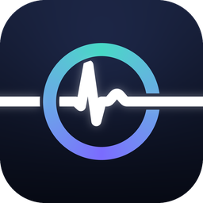
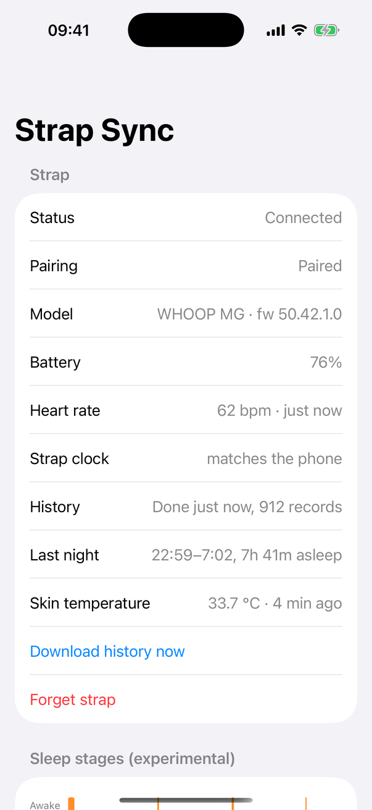
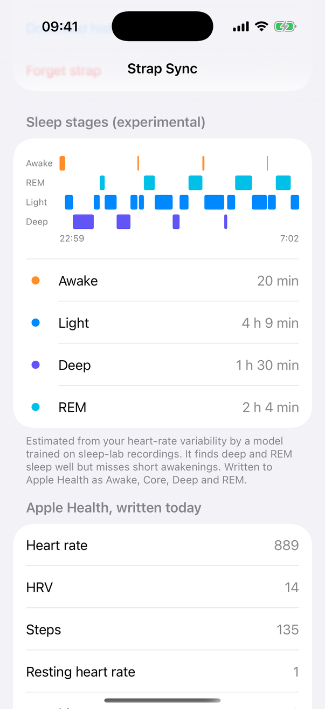
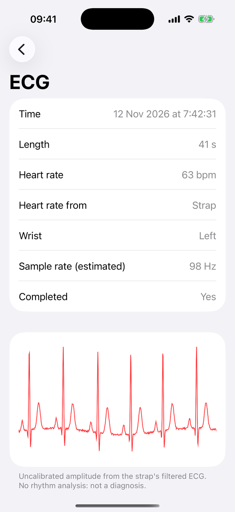
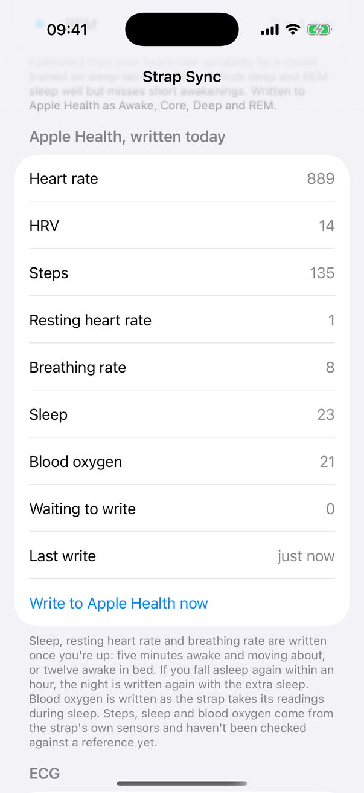
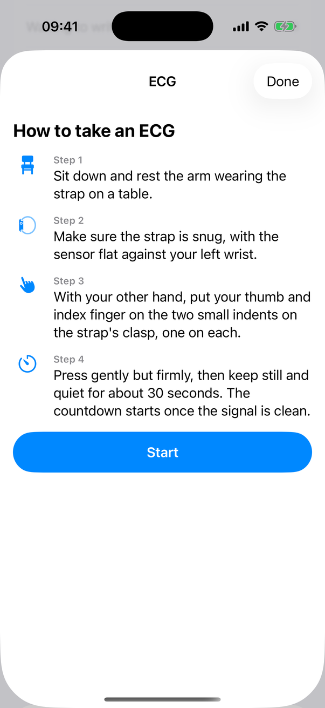

<p align="center">
  
</p>

<h1 align="center">Strap Sync</h1>

<p align="center">
  An iOS app that reads a WHOOP strap over Bluetooth and writes heart rate, HRV, sleep stages and more to
  Apple Health. Everything stays on the phone.
</p>

<p align="center">
  <a href="LICENSE"></a>
  
  
</p>

<p align="center">
  
  
  
</p>
<p align="center"><sub>iOS Simulator with made-up demo data (<a href="docs/DEVELOPMENT.md#the-simulator-and-demo-data">how</a>).</sub></p>

Strap Sync pairs with your own WHOOP strap, downloads what it records, and turns it into Apple Health
samples. There's no account and no server: Apple Health, or an app that reads it, is where you look at the
data. The app itself is one screen showing the strap, last night's sleep stages, what was written today and
your ECGs, plus a log.

## Features

### Read from the strap

- **Live heart rate** and beat-to-beat (RR) intervals over the standard Bluetooth heart-rate service, which
  works before pairing.
- **Stored history**, once paired: heart rate and RR intervals, the step counter, the strap's own sleep flag,
  wrist movement and orientation, skin temperature and blood-oxygen readings. The app sets the strap's clock
  and downloads every 15 minutes, so gaps fill in when the phone comes back in range.
- **ECG** on a WHOOP MG: a guided 30-second recording, kept in the app and shown as a trace. Uncalibrated,
  with no rhythm analysis: not a diagnosis.
- **Battery and skin temperature**, shown in the app.

### Written to Apple Health

| Type | What's written |
|---|---|
| Heart rate | One sample a minute, from minutes with at least 10 readings |
| Heart rate variability (SDNN) | At most one an hour: the 5-minute window with the lowest heart rate, steady ones first, detrended |
| Steps | Per minute, from the strap's step counter |
| Sleep | Each night as Awake, Core, Deep and REM, or asleep and awake when a night can't be staged |
| Resting heart rate | Each night: the lowest 30-minute mean while asleep |
| Respiratory rate | Hourly while asleep, estimated from the RR intervals |
| Blood oxygen | The strap's own readings during sleep: the median of each run |

Every sample carries a sync identifier and version, so writing it again never makes a duplicate and a
recomputed sample replaces the old one. Samples name the strap as their device and record the time zone
they were recorded in, even when they're written again later. The app reads nothing from Health: it only writes.

Health has no type for skin temperature (its wrist-temperature type is reserved for Apple Watch), RMSSD
or a WHOOP ECG. So they go in as metadata on the samples above: each heart-rate sample carries its
10-minute skin temperature, the heart-rate sample of the minute an ECG started carries the recording (or
one of its own, at the recording's heart rate, when that minute has none), and each HRV sample carries
its window's RMSSD. Any app allowed to read heart rate and HRV can read
them; the keys are in [`docs/SHARING.md`](docs/SHARING.md#through-apple-health).

<p align="center">
  
  
</p>

### Sleep stages on the phone

A model in the app stages each finished night from the strap's RR intervals and wrist rotation, then
replaces the night's plain "asleep" in Apple Health with Awake, Core, Deep and REM.

Against hand-scored polysomnography (PSG), it scores Cohen's κ 0.609 (75.7% of 30-second epochs right, four
stages) on 93 held-out nights of healthy adults sleeping at home (Wearanize+, never used in training), and
κ 0.520 on held-out sleep-clinic nights. Those tests used heartbeats from the PSG's ECG, thinned to the
strap's coverage, and a wrist device's movement, not the strap's own optical beats, so the strap itself
hasn't been checked against PSG. Wake is its weakest stage. The app labels the stages experimental.
Details: [`docs/SLEEP_STAGES.md`](docs/SLEEP_STAGES.md).

### Background sync

- iOS wakes the app for the strap's Bluetooth traffic, and relaunches it if it was closed in the
  background. With the phone in range, history downloads every 15 minutes, every 5 while a night is under
  way, and when the app is opened.
- Out of range, the app reconnects when the strap is back and downloads what it stored meanwhile.
- A night is written soon after you're up: five minutes awake and moving about, or twelve awake in bed. If
  you fall asleep again within an hour, it's written again with the extra sleep: as far as it has got
  whenever the phone is unlocked, and whole once you're up.
- While the phone is locked, Apple Health can't be written to. Samples wait in a local outbox and go in once
  it's unlocked, with a background refresh as a fallback.
- If no download completes for 3 hours, a notification says syncing has stopped. Force-quitting the app stops
  iOS relaunching it until it's opened again.

### Works with Wellmaxx, and other apps

Wellmaxx, a health dashboard app, shows what Strap Sync writes to Apple Health. It also reads what Health
can't hold (skin temperature, hourly HRV as RMSSD as well as SDNN, and ECG recordings), which Strap Sync
keeps for 7 days in a keychain group shared on the phone. Both apps must be signed by the same team. The
format is in [`docs/SHARING.md`](docs/SHARING.md).

Any other app gets the same from Apple Health, as metadata on the heart-rate and HRV samples, with only
Health's own permission to read them ([`docs/SHARING.md`](docs/SHARING.md#through-apple-health)).

## How it works

```
WHOOP strap ──Bluetooth──▶ StrapLink ──▶ SQLite store ──▶ SyncCore ──▶ outbox ──▶ Apple Health
```

- **Bluetooth** (`App/WhoopSync/BLE`): finds the strap by its WHOOP service, pairs it, sets its clock and
  requests history, one operation at a time. History arrives in chunks, and each chunk is saved before it's
  acknowledged, because the acknowledgement lets the strap delete it.
- **Local store** (`App/WhoopSync/Store`): SQLite, using the system library, writable while the phone is
  locked. Beats and per-second records are kept for 14 days, and planned Health samples stay in an outbox
  until Health has saved them.
- **SyncCore** (`Packages/SyncCore`): pure Swift with no Bluetooth or HealthKit, unit-tested on the Mac. It
  holds the protocol subset (framing, checksums, history records) and everything that turns records into
  samples: per-minute heart rate, hourly HRV, steps, nights, resting heart rate, breathing rate, blood oxygen,
  ECG and the sleep stager.
- **The sleep model:** two LightGBM stages and a bidirectional GRU over HRV features, averaged, plus a third
  LightGBM over wrist rotation (from the strap's gravity vector) that moves wake against sleep, smoothed by a
  tempered Viterbi pass. The heart models are trained on 1,027 open ECG sleep-lab nights (CinC 2018 and HMC),
  the rotation model on 276 open Apple Watch nights (sleep-accel and BIDSleep). The Swift port is checked
  against the Python it came from.
- **HealthKit** (`App/WhoopSync/Health`): saves the outbox in batches of up to 500, oldest first. A night
  that's recomputed is deleted from Health before it's written again.

The app has no third-party code. Design and reasoning: [`docs/SPEC.md`](docs/SPEC.md). What's built and
what's been seen working: [`docs/PROGRESS.md`](docs/PROGRESS.md).

## Supported hardware

- **WHOOP MG:** tested. The app was developed on one MG with an iPhone 16 Pro, where pairing, background
  history downloads, nights, sleep stages, ECG and Health writes have been seen working
  ([`PROGRESS.md`](docs/PROGRESS.md)).
- **WHOOP 5.0:** shares the MG's protocol, so it's expected to work, but hasn't been tested. It has no ECG.
- **WHOOP 4.0 and earlier:** not supported.

Strap Sync takes the strap's Bluetooth bond, so it can't share the strap with the WHOOP app on the same
phone.

## Privacy

- The app has no account, no analytics and no networking code. It never sends anything anywhere.
- Everything it keeps is on the phone: its database, its logs and a 7-day archive of raw strap data (the last
  two visible in the Files app, under On My iPhone → Strap Sync), and the samples you let it write to Apple
  Health.
- For Wellmaxx, a few items are shared on the phone through a keychain group that isn't synced to iCloud.
- Skin temperature, RMSSD and ECG recordings also go into Apple Health, as metadata on heart-rate and HRV
  samples, so any app you let read heart rate or HRV can read them too.
- Its privacy manifest declares no tracking and no collected data.
- What's in Apple Health then follows Health's own settings, such as iCloud sync.

## Requirements

- An iPhone with iOS 17 or later.
- A WHOOP MG, or a WHOOP 5.0 (untested), not in use with the WHOOP app on the same phone.
- To build it: a Mac with Xcode (it's built with Xcode 16.4 and 26.3) and [XcodeGen](https://github.com/yonaskolb/XcodeGen),
  and an Apple ID to sign with. A free personal team can sign it, but its builds expire after 7 days.

## Building from source

```sh
brew install xcodegen
git clone https://github.com/wikoion/strap-sync.git
cd strap-sync
cp Config/Local.xcconfig.example Config/Local.xcconfig
```

Set your own team and bundle ID in `Config/Local.xcconfig`. Git ignores it, so nothing in the repo is tied to
one team:

```
DEVELOPMENT_TEAM = ABCDE12345
APP_BUNDLE_ID = com.yourname.WhoopSync
```

Then generate the Xcode project from `project.yml` (the generated project is git-ignored too), and run the
`WhoopSync` scheme on your iPhone:

```sh
xcodegen generate
open WhoopSync.xcodeproj
```

`scripts/install-app.sh` builds and installs on a connected iPhone in one step. The tests run on the Mac:

```sh
cd Packages/SyncCore && swift test
```

The project and target are still called WhoopSync; the app's name on the phone is Strap Sync. The Simulator
has no Bluetooth, but a Debug build launched there with `-demo YES` shows made-up data. TestFlight uploads,
pulling logs off the phone and demo mode are in [`docs/DEVELOPMENT.md`](docs/DEVELOPMENT.md).

### First run

1. Delete the WHOOP app from the phone: it competes for the strap.
2. Open Strap Sync → Connect Apple Health → allow every type.
3. Find strap → pick it. If iOS asks to pair, tap Pair.
4. If pairing fails: Settings → Bluetooth → WHOOP → Forget This Device, tap the strap until its lights flash
   blue, then tap Pair in Strap Sync.

## Project layout

```
App/WhoopSync/            the iOS app
  BLE/                    Bluetooth: finding, pairing, live heart rate, history download
  Health/                 writing to Apple Health
  Store/                  the SQLite store and outbox
  Sharing/                the keychain items shared with Wellmaxx
  UI/                     SwiftUI screens
  Support/                logging, the raw archive, demo data
Packages/SyncCore/        protocol, samples, nights, ECG and the sleep stager, with tests
Config/                   build settings; Local.xcconfig (yours, git-ignored) sets team and bundle ID
research/sleep-stages/    Python that trains, evaluates and exports the sleep model
design/                   app icon sources
docs/                     spec, progress log, sleep stages, sharing, development
scripts/                  install-app.sh and testflight.sh
project.yml               the XcodeGen spec
```

## Research

- **`research/sleep-stages/`** holds the Python behind the sleep model: HRV and wrist-rotation features,
  LightGBM, the GRU, cross-validation on each dataset, and `export_model.py`, which writes the weights the
  app ships and refuses the evaluation-only datasets. Results, comparisons and how to rerun them are in
  [`docs/SLEEP_STAGES.md`](docs/SLEEP_STAGES.md).
- **Datasets** aren't in the repo, apart from two small test-fixture excerpts; the scripts read them from
  elsewhere. [`DATASETS.md`](DATASETS.md) lists each one with its licence and citation, and whether it trains
  the shipped weights or is used for evaluation or research only.

## Status

A personal project, built for one person's strap and phone and shared as it is. It isn't on the App Store.

- It runs on the developer's own MG and iPhone; [`docs/PROGRESS.md`](docs/PROGRESS.md) logs what has and
  hasn't been seen working there.
- Steps, sleep and blood oxygen come from the strap's own sensors and haven't been checked against a
  reference device. Sleep stages are experimental.
- The app also keeps the strap's 25 Hz optical bursts (40 seconds every 20 minutes) in its database as they
  arrive, for later study. Nothing in the app uses them yet.

## Licence

MIT, see [`LICENSE`](LICENSE). The datasets keep their own licences ([`DATASETS.md`](DATASETS.md)).

## Acknowledgements

The protocol code is an independent implementation. Protocol facts (UUIDs, frame layouts, command
numbers, byte offsets) come from the public reverse-engineering in
[b-nnett/goose](https://github.com/b-nnett/goose), [ryanbr/noop](https://github.com/ryanbr/noop) (its
docs and issues) and [LeonardSEO/wearable5.0](https://github.com/LeonardSEO/wearable5.0). None of their
code is copied.
The sleep model is trained on open datasets, listed with their licences and citations in
[`DATASETS.md`](DATASETS.md).

## Disclaimer

Not affiliated with or endorsed by WHOOP, Inc. WHOOP is a trademark of WHOOP, Inc., used here only to
say which straps the app works with. Not a medical device: its numbers aren't for diagnosis or
treatment. Use at your own risk.
